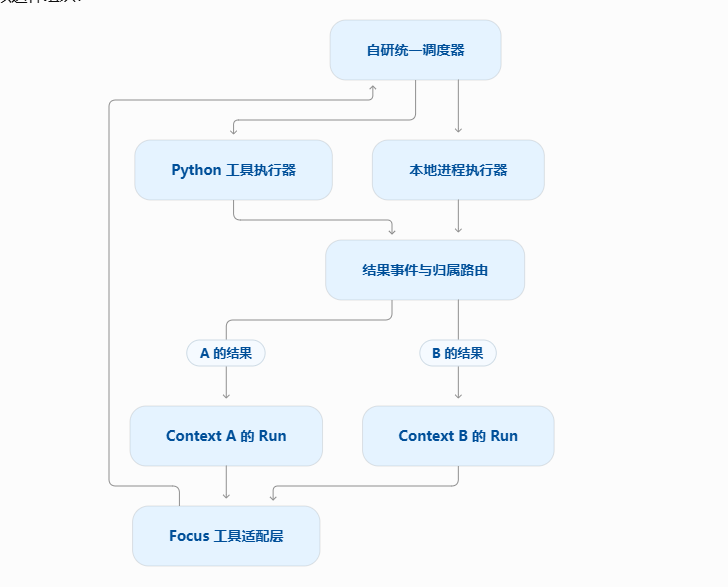

# focus-tool-runtime

研究如何缩短 Agent 从工具提交到有效后续行动的时间。调度与事件机制自研，使用 Go／Python 标准库、本地文件和本地进程；不依赖模型 API、LangChain 或现成任务队列服务。

**已实现原图的本地完整闭环**：多 Context／Run 共用有界调度器，分别执行 Python 工具和本地进程，结果按归属返回 Run，并支持提前重规划、依赖绑定、资源互斥、取消确认和耐久结果重投。保留 M1 的三个对照模式。Focus 适配接口在本仓库提供，未修改或部署 Focus 主仓。

已补取消等待、提交接收不确定和 Run 容量隔离边界，并通过真实 Focus Run 小范围联调。完整链路的历史性能测试见 [边界修复与完整链路性能](docs/boundaries-and-performance.md)。本轮增加按条数／字节分页、活动状态与磁盘历史分离、WAL 分段压缩及有界近期缓存，见 [历史保留策略与验收](docs/history-retention.md)。不将有限负载实验解释为生产 Patrol 的长期稳定性证明。

## 目标架构

下图属于本会话首条需求，是本仓库的目标架构与验收标准。实现和设计文档按原图的模块及连接关系推进。



执行闭环为：Context A／B 的 Run → Focus 工具适配层 → 自研统一调度器 → Python／本地进程执行器 → 结果事件与归属路由 → 对应 Context 的 Run。多个会话的工具集中调度，A、B 的结果分别回到所属 Run；Run 消费结果后继续提交或调整工作。

完整模块职责、结果消费约束和逐项实现状态见 [研究设计](docs/design.md#标准架构与验收范围)。

## 开始运行

需要 Go 1.24+ 和 Python 3.10+。在仓库目录执行完整架构演示：

```powershell
python examples/demo.py
```

一次运行全部 Go 测试、静态检查、Python 集成测试和完整演示：`python scripts/verify.py`。GitHub Actions 在 Windows 和 Linux 上执行同一检查，Linux 另做 race 检测。

演示自动构建运行时，在临时工作区启动两个 Run，验证配置修复、失效进程取消、归属路由和 Python 依赖参数绑定。原始轨迹写入 `results/local/full-runtime.json`。已保存一次 [完整闭环轨迹](results/full-runtime-2026-10-27.json)。

运行新增完整链路的 barrier／event 对照、持续多 Context 负载，以及无需纠偏的负对照：

```powershell
python benchmarks/full_runtime.py
python benchmarks/full_runtime.py --negative-control --repeat 3 --out results/local/negative-control.json
python benchmarks/retention.py --out results/local/retention.json
```

真实 Focus 接入需要其现有 Python 环境、源码与本机缓存的 PostgreSQL Docker 镜像，复现方法见 [接入说明](integration/focus/README.md)。核心测试不要求安装这些额外依赖。

短工具阶段测量须单独运行，避免与测试或其他实验并行：

```powershell
python benchmarks/short_tools.py --out results/local/short-tools/report.json
python benchmarks/analyze_short_tools.py results/local/short-tools/report.json --out results/local/short-tools/summary.json
```

该基准覆盖单／多 Context、真实多轮压缩、追踪开／关对照及读回核验的耐久后续产物；每轮原始轨迹以 gzip JSONL 保存。阶段、时钟和统计范围见 [测量合同](docs/short-tools-method.md)。

运行保留的 M1 性能对照：

```powershell
go run ./cmd/lab
```

默认各模式运行 3 次，终端展示每次耗时及中位数，原始事件保存至 `results/local/report.json`。增加重复次数或改变工作量：

```powershell
go run ./cmd/lab -repeat 5 -passes 256 -out results/local/report.json
go test ./...
go vet ./...
python -m unittest discover -s python/tests -v
```

正式比较使用相同 Go 版本、工作量和机器负载。每轮轮换模式顺序；编译、生成数据和最后写报告不计入 trial，子进程启动、工具执行、结果消费、修复及取消确认计入。无固定百分比通过阈值。

## 首个对照实验

同一计划提交 `check` 和 `scan`：前者实际读取配置，发现 `valid=false`；后者对同一份固定 8 MiB 文件执行 256 遍 SHA-256。扫描是人为放大的、可撤销的只读工作负载。确定性控制器读取检查结果后，产生计划版本 2，启动 `repair` 写入独立输出文件并读回验证。

| 模式 | 工具执行和结果消费 |
|---|---|
| serial | 顺序执行这批工具，整批返回后决策；仅作为批处理参照 |
| barrier | 两个进程并发，整批完成后消费结果，再修复 |
| event | 两个进程并发，检查结果到达即决策，取消扫描并修复 |

三者的工具输入和最终验收相同。`barrier` 和 `event` 的并发上限均为 2；`serial` 有意只使用一个执行机会。串行模式没有模拟“读到检查结果就跳过扫描”的专用优化策略。节省来源是减少无效执行与等待，并非让同一扫描算法运行得更快。

每轮还会故意重放检查结果以验证去重。事件模式中，计划 1 的扫描终态仍进入执行记录，但会被计划 2 的收件箱拒收。只有 `cmd.Wait()` 返回后才记录实际进程终态，且总耗时包含取消确认。

本机首轮结果见 [M1 实验报告](docs/m1-results.md)，完整试验轨迹见 [原始 JSON](results/m1-2026-10-27.json)。这些结果只说明该工作负载的机制收益，尚未测量真实模型决策或 Focus 完整运行。

## 阅读入口

- [源码核验和协议约束](docs/protocol-research.md)：核验 Focus 的工具回合、消息配对、取消与权限边界。
- [研究设计与里程碑](docs/design.md)：研究问题、当前边界、后续实验及接入条件。
- [运行时协议与 Focus 接入](docs/runtime.md)：JSONL 协议、执行准入、恢复、消费回执和接入示例。
- [完整架构验证记录](docs/verification.md)：测试范围、结果、原始输出与验证限制。
- [边界修复与完整链路性能](docs/boundaries-and-performance.md)：三项回归、最新对照、负对照和持续负载结果。
- [真实 Focus 接入](integration/focus/README.md)：真实权限、租约、checkpoint 和结果唤醒的执行依据。
- [历史分页与有界状态](docs/history-retention.md)：保留策略、磁盘布局、压缩恢复、游标及万次完整链路实验。
- [万次任务验收结果](docs/retention-results.md)：320 次 Run 生命周期、近期缓存／Go 堆、原始轨迹及尚未覆盖的 Patrol 边界。
- [短工具测量合同](docs/short-tools-method.md)：持久确认、准入、进程／函数、交付／消费、压缩和锁等待的精确边界。
- [短工具实测与优化选择](docs/short-tools-results.md)：单／多 Context 分位数、54 次压缩、追踪扰动；下一项选择有界 Python worker 池。
- `runtime`：共享调度器、Python／进程执行器、资源与依赖、耐久事件和结果路由。
- `cmd/runtime`：本地 stdio JSONL 服务，一个连接可承载多个 Context 的 Run。
- `python/focus_tool`：Focus 调用适配层、执行前检查、按 Run 分发与消费结果。
- `internal/runtime`、`cmd/lab`：保留的 M1 执行器与三个对照模式。

执行器目前要求工具是可信的叶子进程，不提供通用 Shell 进程树治理。资源名称由调用方显式声明，权限和租约由实际 Focus 接入方的执行前回调复核。运行时崩溃时，未确认执行记为 `unknown`，禁止自动重放并保留冲突资源和任务额度；需要人工核查，未提供自动清理与重试。WAL 已支持在线分段压缩；磁盘身份与结果保留至今，不提供破坏性过期清理。内存模式没有历史有界承诺。详见 [运行边界](docs/runtime.md#运行边界)。
